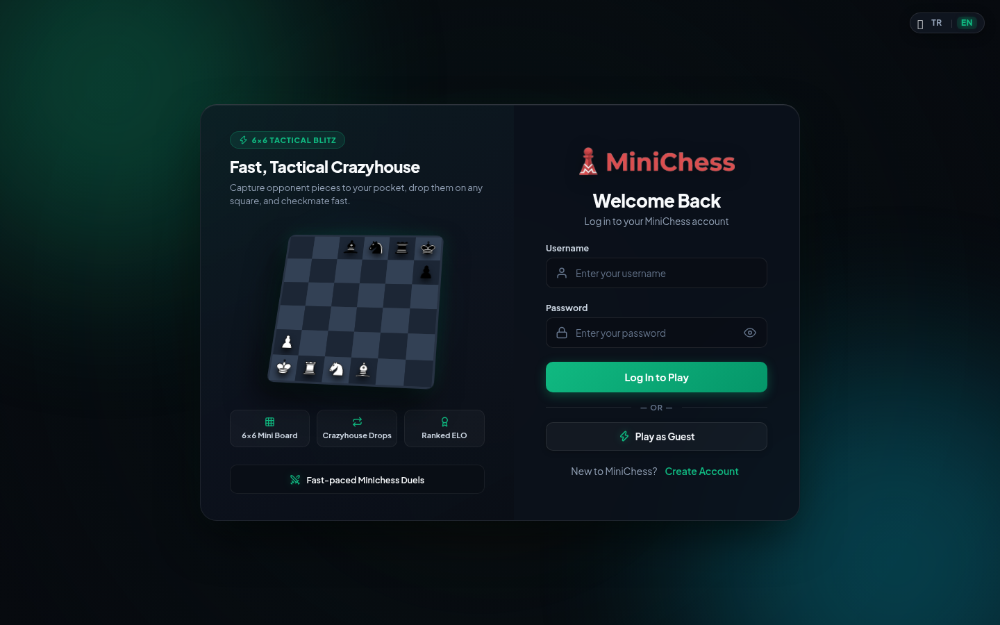

<div align="center">


# MiniChess — 6×6 Tactical Crazyhouse

**Fast-paced, competitive 6×6 Crazyhouse chess built for the web.**  
Capture opponent pieces into your pocket, drop them back onto any empty square, and deliver lightning-fast checkmates.

[](https://minichess.xyz)
[](https://nodejs.org/)
[-003B57?style=for-the-badge&logo=sqlite&logoColor=white)](https://sqlite.org/)
[](#-testing--verification)
[](#)

<br />

<a href="https://minichess.xyz">
  
</a>

</div>

---

## ⚡ Overview

**MiniChess** combines the tactical depth of **Crazyhouse** with the speed of a compact **6×6 board** (`2bnrk/5p/6/6/P5/KRNB2`). Every piece you capture enters your personal **Pocket**, ready to be parachuted back onto the board on any subsequent turn as your own piece.

 Play live right now at **[https://minichess.xyz](https://minichess.xyz)** — jump in immediately with **1-Click Guest Mode** or create a ranked account!

---

## 🌟 Key Features

### ♟️ Core Gameplay & Modes
- **6×6 Crazyhouse (Standard Ranked):** Full Crazyhouse pocket & drop mechanics, pawn promotion on the 6th/1st rank, check/checkmate detection, and ELO rating adjustments.
- **🎲 Dice Chess Mode:** Roll a die each turn to determine which piece type you must move or drop — adding high-speed tactical improvisation.
- **⏱️ Custom Time Controls:** Choose between **1+0 Bullet** (60s), **3+0 Blitz** (180s), and **5+0 Rapid** (300s) in private rooms and bot matches.
- **🤖 10-Tier AI Bot Engine (`Worker Threads`):** Play against 10 distinct AI personalities (*Toddler 600 ELO* up to *Master 2100 ELO*) powered by a non-blocking minimax search worker with **Takeback (Undo)** and **Best-Move Hint** support.

### 👁️ Live Spectator & Post-Game Review
- **Live Matches Showcase:** Browse ongoing ranked, dice, and bot duels directly from the lobby Bento Grid with live turn indicators and viewer counts.
- **Real-Time Spectator Mode:** Watch any active match live with synchronized clocks, pockets, and move notation — fully isolated at the socket layer so spectators cannot interfere with gameplay.
- **Interactive Post-Game Move Stepper & FEN Export:** Step backward and forward (`<<`, `<`, `>`, `>>` or keyboard arrow keys) through every move after a game finishes, highlight active moves, and copy the Crazyhouse **FEN** string in one click.

### 🏆 Esports Progression & Gamification
- **Competitive League Tiers:** Climb from *Bronze* → *Silver* → *Gold* → *Platinum* → *Diamond* → *Master* with dynamic ELO badges.
- **Daily Quests:** Complete daily tactical objectives (*Complete 1 Match*, *Drop 2 Pieces from Pocket*, *Defeat a Bot*) to claim bonus Battlepass XP.
- **7-Day Login Streak:** Escalating daily login rewards culminating in the **Day 7 Grand Prize** (+500 XP, +250 Coins, and the exclusive **Streak Master** crown badge).
- **Battlepass & Cosmetic Shop:** Unlock and equip custom **Board Themes**, **Victory Confetti Effects**, **Username Colors**, and **Player Titles**.

### 🔊 Audio, UI & Localization
- **Web Audio API Synthesizer & Sound Engine:** Crisp move, capture, drop, check, game-over, match-found fanfare, and 10-second low-time countdown alerts with a persistent **0–100% Volume Slider** & quick mute toggle.
- **Modern Dark Esports Theme:** Built with *Plus Jakarta Sans*, *JetBrains Mono*, glassmorphic Bento panels, custom confirmation modals (`ESC` / `Enter` shortcuts), and *Lucide Icons*.
- **Full Bilingual i18n (`TR` / `EN`):** 350+ synchronized dictionary keys with instant client-side language switching.
- **Comprehensive Admin Panel:** Real-time server statistics, user management (ban/unban, admin toggle, coin/XP grants, stat resets), active match termination, and global server broadcasts.

---

## 🛠️ Tech Stack

| Layer | Technology |
| :--- | :--- |
| **Backend Runtime** | Node.js + Express.js |
| **Real-Time Engine** | Socket.IO (Matchmaking, Clocks, Live Spectating, Rooms) |
| **AI Computation** | Node.js `worker_threads` (Alpha-Beta Minimax + Crazyhouse Evaluation) |
| **Database** | SQLite via `sql.js` (WAL mode + automatic disk persistence) |
| **Authentication** | `express-session` + `bcryptjs` + Seamless Guest Session Fallback |
| **Frontend** | Vanilla HTML5, CSS3, ES6+ JavaScript (Zero heavy frontend framework overhead) |

---

## 🚀 Getting Started

### Prerequisites
- **Node.js** `v18+` recommended

### Installation & Local Development

```bash
# 1. Clone the repository
git clone https://github.com/Fuwia/minichess.git
cd minichess

# 2. Install dependencies
npm install

# 3. Start the server (default port: 3000, or set PORT=4567)
npm start
```

Open **`http://localhost:3000`** in your browser to start playing.

---

## 🧪 Testing & Verification

MiniChess includes **6 automated verification suites** covering 546 assertions across the chess engine, REST APIs, Socket.IO events, admin security guards, spectator isolation, and i18n parity:

```bash
node test_suite.js                    # Core engine, i18n, guest & auth flows (112 tests)
node test_admin_suite.js              # Admin panel permissions & user management (62 tests)
node test_new_features.js             # Sound synthesizer, mute, modals & quests (67 tests)
node test_spectator_streak_volume.js  # Spectator mode, 7-day streak & volume slider (154 tests)
node test_deep_edge_cases.js          # Null-safety, drag guards & i18n parity (27 tests)
node test_package3_suite.js           # Custom time controls, bot takeback/hint & FEN review (124 tests)
```

---

## 🎮 How to Play 6×6 Crazyhouse

1. **Compact 6×6 Board:** Files `a–f` and ranks `1–6`. White starts on ranks `1–2`, Black on ranks `5–6`.
2. **Pocket Drops:** Every opponent piece you capture is converted to your color and placed into **Your Pocket**. On any turn, instead of moving a piece on the board, you may drop a pocket piece onto any empty square *(pawns cannot be dropped on the 1st or 6th rank)*.
3. **Promotion:** Pawns promote automatically upon reaching the farthest rank (rank 6 for White, rank 1 for Black).
4. **No Castling:** Due to the compact 6×6 geometry, castling is disabled — action begins on move 1!

---

## 📝 License

This project is open-source and available under the **MIT License**.
